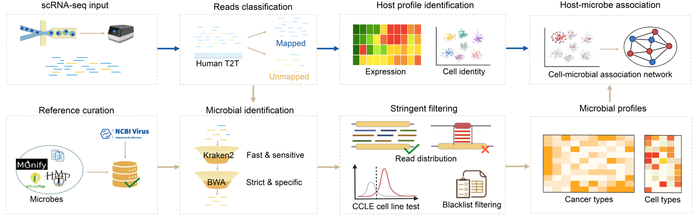

# sc-MIST

**sc-MIST** (**single-cell Microbial Identification with Stringent Testing**)
is a reproducible pipeline for identifying high-confidence microbial reads in host-dominated single-cell RNA-seq data.

The workflow combines a curated human-associated microbial reference, Kraken2 classification cross-checked by BWA-MEM alignment, genome-wide read-distribution filters, and literature-based contaminant curation to suppress false positives, then links each microbial detection to host-cell identity and transcriptional state via cell barcodes.

The workflow was developed for the study:

> **A Pan-Cancer Cell-Associated Microbiome Atlas Reveals Inter- and Intra-Tumor
> Heterogeneity** (under review)

This repository provides a synthetic 3-sample demo dataset​ for a quick start.

---

## Contents

- [Workflow](#workflow)
- [Repository contents](#repository-contents)
- [Requirements](#requirements)
- [Input data](#input-data)
- [Quick start: run the 3-sample demo](#quick-start-run-the-3-sample-demo)
- [Reference preparation](#reference-preparation)
- [Configure a real project](#configure-a-real-project)
- [Step-by-step pipeline](#step-by-step-pipeline)
- [Filtering rules](#filtering-rules)
- [Output files](#output-files)
- [Running all samples at once](#running-all-samples-at-once)
- [Citation, acknowledgements, and license](#citation-acknowledgements-and-license)

---

## Workflow

```text
Cell Ranger outs/possorted_genome_bam.bam
        │
        ▼
01  Extract human-unmapped reads (keep barcode + UMI)
        │
        ▼
02  Kraken2 classification against the sc-MIST database
        │
        ▼
03  Extract microbial reads and read-to-taxid assignments
        │
        ▼
04  BWA validation against taxon-specific references
        │
        ▼
05  HLA/MHC + human rRNA filtering, then refresh read-to-taxid assignments
        │
        ▼
06  Barcode-level k-mer correlation filter
        │
        ▼
07  Sample-level k-mer correlation filter (requires >= 3 samples)
        │
        ▼
08  Cell-line RPMM 90th-percentile filter
        │
        ▼
09  DECONTAM frequency-based contamination filter
        │
        ▼
10  Final taxon/blacklist filters and UMI quantification
        │
        ▼
11  Bacterial retention + viral host-evidence filter + final matrices
```



---

## Repository contents

```text
sc-MIST/
├── README.md
├── environment.yaml
├── config/
│   ├── config.example.sh          # copy to config/config.sh
│   └── samples.example.tsv        # sample_id <TAB> cellranger_outs
├── scripts/
│   ├── 01_extract_unmapped.sh
│   ├── 02_kraken_classify.sh
│   ├── 03_extract_microbial_reads.R
│   ├── 04_validate_taxa_bwa.R
│   ├── 05_filter_host_and_refresh.sh
│   ├── 05_filter_host_residuals.R
│   ├── 06_barcode_denoising.R
│   ├── 07_sample_denoising.R
│   ├── 08_filter_cellline.R
│   ├── 09_decontam.R
│   ├── 10_quantify_filter.R
│   ├── 11_summarize.R
│   ├── run_pipeline.sh
│   └── utils/
│       ├── bwa_filter.awk
│       ├── build_bwa_library.sh
│       ├── build_lineage_matrix.R
│       ├── check_references.sh
│       ├── kreport2mpa.py
│       ├── read_fasta.R
│       └── refresh_taxid_assignments.sh
├── resources/
│   ├── curated_bacteria_species.tsv
│   ├── kraken_overlap_databases_score6.xlsx
│   ├── CCLE_quantile_mhc_rrna.txt
│   ├── HVIDB_PPIs.txt
│   ├── humanvirusbase_Virus_Organ_pairs.csv
│   ├── black_list.txt
│   ├── mgnify_black.txt
│   └── ccle_blacklist_taxids.txt
├── demo/
│   ├── make_demo.py
│   ├── build_reference.sh
│   ├── run_demo.sh
│   ├── config.demo.sh
│   ├── samples.tsv
│   ├── check_results.sh
│   ├── input/                     # committed toy Cell Ranger-style output
│   ├── reference/                 # committed toy source FASTA and tables
│   └── expected/                  # expected final tables
├── docs/
│   ├── 00_quickstart.md
│   ├── 01_reference_build.md
│   ├── 02_step_by_step.md
│   ├── 03_outputs.md
│   ├── 04_demo.md
│   └── 05_troubleshooting.md
├── assets/
│   └── sc-MIST_pipeline.png
├── LICENSE
└── .gitignore
```

`demo/reference/kraken_db/` and `demo/reference/bwa_library/` are generated
locally by `demo/build_reference.sh` and are intentionally ignored by git.

---

## Requirements

### Software

- Linux (recommended) or macOS with Bash >= 3.2
- [Conda](https://docs.conda.io/) or [Mamba](https://mamba.readthedocs.io/)
- Cell Ranger with `bamtofastq` on `PATH` for real Cell Ranger BAMs
- Python >= 3.10
- R >= 4.3 and < 4.5 (the manuscript analysis used R 4.4)

The pipeline uses:

- Kraken2 2.1.3 (the manuscript used `Kraken2Uniq`)
- BWA 0.7.18
- samtools 1.21
- SeqKit 2.6.1
- seqtk
- taxonkit 0.16.0 for building the lineage matrix
- R packages: `optparse`, `dplyr`, `tidyr`, `stringr`, `data.table`,
  `readr`, `Matrix`, and `decontam`

### Create the environment

```bash
conda env create -f environment.yaml
conda activate scmist
```

Check the R packages:

```bash
Rscript -e 'for (p in c("optparse","dplyr","tidyr","stringr","data.table","readr","Matrix","decontam")) cat(p, requireNamespace(p, quietly=TRUE), "\n")'
```

`bamtofastq` is distributed with Cell Ranger, not Conda. Either put the Cell
Ranger `bamtofastq` executable on `PATH`, or set `BAMTOFASTQ` in
`config/config.sh` to its absolute path.

---

## Input data

### FASTQ Processing

sc-MIST can be applied to both 10x and non-10x data. For 10x data, the analysis starts directly from the Cell Ranger outputs; for non-10x data, we recommend running the FASTQ files through zUMIs​ first, to demultiplex cell barcodes and UMIs and align reads to the reference genome (GENCODE v32), so that the output matches the read structure expected by this pipeline. In what follows, we illustrate the pipeline using 10x data as an example.

For each sample, provide the standard Cell Ranger `outs/` directory. The pipeline needs:

```text
/path/to/sample1/outs/possorted_genome_bam.bam
/path/to/sample1/outs/filtered_feature_bc_matrix/barcodes.tsv.gz
```

`barcodes.tsv.gz` is optional. It is used only when `CELLRANGER_FILTER=1`
(default) to restrict the final cell-level table to Cell Ranger cell-called
barcodes. If the file is absent, set `CELLRANGER_FILTER=0`.

Common 10x settings:

| Chemistry | `BC_LEN` | `UMI_LEN` |
|---|---:|---:|
| 10x v2 | 16 | 10 |
| 10x v3 | 16 | 12 |

The demo uses 16 + 10. Change `BC_LEN` and `UMI_LEN` in `config/config.sh` if
your chemistry differs.

### Sample table and sample count

Create `config/samples.tsv` with a tab-separated table:

```text
sample_id	cellranger_outs
sample1	/path/to/sample1/outs
sample2	/path/to/sample2/outs
sample3	/path/to/sample3/outs
```

> **At least 3 samples are required.** Step 07 estimates sample-level
> correlations. Three samples is the mathematical minimum; more samples give a
> more stable estimate. Do not use a 1–2 sample project for the strict filter.

---

## Quick start: run the 3-sample demo

The demo is synthetic. It exercises all 11 steps in about one minute on a
laptop and does not require downloading the production Kraken2 database or BWA
library.

```bash
conda activate scmist
bash demo/run_demo.sh
```

`demo/run_demo.sh` does four things:

1. regenerates the toy Cell Ranger-style inputs and reference source files with
   `python3 demo/make_demo.py`;
2. builds the toy Kraken2 database and toy BWA indices with
   `bash demo/build_reference.sh`;
3. runs steps 01–11 with `demo/config.demo.sh`;
4. writes results under `demo/results/`.

Check the result:

```bash
bash demo/check_results.sh
cat demo/results/11_summary/taxon_umi_matrix.tsv
```

Expected final matrix:

```text
taxid	sample1	sample2	sample3
1000	40	80	120
1002	20	40	60
2001	20	40	60
3001	20	40	60
```

Expected per-sample QC:

```text
sample	microbial_umi	taxa_detected	barcodes_with_microbes
sample1	100	4	8
sample2	200	4	8
sample3	300	4	8
```

The four retained taxa are `1000`, `1002`, `2001`, and `3001`. The toy HLA
reference intentionally removes taxon `1001`, and the genus-level taxa `2000`
and `3000` do not pass the barcode-level test. This demonstrates that the
filters are active.

### Inspect the input/output of every demo step

The demo uses the same directory layout as a real project:

```text
demo/results/
├── 01_unmapped/sample1/
├── 02_kraken/sample1/
├── 03_microbial/sample1/
├── 04_bwa/sample1/
├── 05_host_filter/sample1/
├── 06_denoise/sample1/
├── 07_sample_denoise/
├── 08_cellline/sample1/
├── 09_decontam/
├── 10_quantify/sample1/
├── 11_summary/
└── logs/
```


Observed demo values for `sample1` (project-level values use all three samples):

| Step | Main output | Expected observation |
|---:|---|---|
| 01 | unmapped BAM + R1/R2 + barcode+UMI R1 | 103 read pairs |
| 02 | Kraken output/report/MPA + classified FASTQ | 103 pairs classified |
| 03 | microbial FASTA + microbiome output | 101 R1 records; 11 microbial taxids |
| 04 | BWA-pass reads + BWA blacklist | 7 validated taxa; 182 pass records |
| 05 | clean FASTQ + refreshed Kraken output | 80 clean pairs; 10 refreshed taxids |
| 06 | barcode k-mer hits + RPMM table | 4 taxa with barcode hits |
| 07 | `sample_denoising.tsv` | 6 taxa across 3 samples |
| 08 | cell-line hit tables | 6 candidate taxa per sample |
| 09 | `decontam.tsv` | 6 taxa; none rejected (p ~ 1 in this toy example) |
| 10 | counts/filtered counts/abundance/QC | 4 retained taxa; 100 UMIs; 8 barcodes |
| 11 | final matrices and annotations | 4 taxa × 3 samples |

A copy of the expected final tables is in `demo/expected/`.
More detail is in [`docs/04_demo.md`](docs/04_demo.md).

---

## Reference preparation

The small, auditable tables are in `resources/`. The large sequence references
are **not** distributable with the repository and must be downloaded or built
once. The expected reference layout is:

```text
reference/
├── kraken_db/                       # KRAKEN_DB
│   ├── hash.k2d
│   ├── opts.k2d
│   └── taxo.k2d
├── bwa_library/                     # BWA_LIBRARY
│   ├── <taxid>.fa
│   └── <taxid>.fa.{amb,ann,bwt,pac,sa}
├── host_residual.fa                 # HOST_RESIDUAL_FASTA
├── host_residual.fa.{amb,ann,bwt,pac,sa}
└── taxonkit_lineage_matrix.tsv      # TAXON_LINEAGE
```

The cell-line table is already bundled at
`resources/CCLE_quantile_mhc_rrna.txt`; no separate q90 file is needed.

Check the references before running real data:

```bash
cp config/config.example.sh config/config.sh
$EDITOR config/config.sh
bash scripts/utils/check_references.sh --config config/config.sh
```

### Reference checklist

| Resource | Bundled? | Used in | What to provide |
|---|---:|---|---|
| Curated bacterial species | Yes: `resources/curated_bacteria_species.tsv` | 04 | 3,808 species with score >= 6 |
| Kraken2 scoring workbook | Yes: `resources/kraken_overlap_databases_score6.xlsx` | audit | seven essential columns; score >= 6 only |
| Kraken2 database | No | 02, 05 | directory containing `hash.k2d`, `opts.k2d`, `taxo.k2d` |
| Taxon-specific BWA library | No | 04 | one indexed `{taxid}.fa` per species/genus |
| HLA + human rRNA FASTA | No | 05 | one combined, BWA-indexed FASTA |
| Taxonkit-style lineage matrix | No | 04, 11 | TSV with seven required columns |
| Cell-line RPMM 90th percentile | Yes: `resources/CCLE_quantile_mhc_rrna.txt` | 08 | `taxid` plus `threshold_0.9_exclude0` |
| Lab/MGnify/CCLE blacklists | Yes | 10 | three small text files |
| NCBI Virus host metadata | No (too large) | 11 | download from NCBI Virus; ~1.3 GB |
| HVD and HVIDB evidence | Yes | 11 | bundled as CSV/TXT |

### 1. Kraken2 database

The database used in the manuscript contains four components:

- **Human:** T2T-CHM13v2.0
- **Bacteria:** Kraken2 bacterial reference genomes, restricted to taxa with
  prior evidence of human association
- **Viruses:** human-infecting viral genomes from NCBI Virus / RefSeq
- **Taxonomy:** NCBI taxonomy

The source snapshots were:

| Component | Source | Snapshot |
|---|---|---|
| Human genome | T2T-CHM13v2.0, `chm13v2.0.fa.gz` | `https://s3-us-west-2.amazonaws.com/human-pangenomics/T2T/CHM13/assemblies/analysis_set/chm13v2.0.fa.gz` |
| Bacteria | Kraken2 bacterial library | filtered to 3,808 species |
| Viruses | NCBI Virus / RefSeq, human host filter | download date 2024-04-24 |
| Taxonomy | NCBI taxdump | 2024-05-27 |
| Kraken2 | bioconda Kraken2 | v2.1.3; k-mer length 35 |

The bacterial species universe was compared with four human-associated
resources: PMID 32467386, HMP, MGnify, and mBodyMap. A hit was scored at the
level of the match:

```text
species = 3
genus   = 2
phylum  = 1
```

Scores were summed across the four resources. Species with **score >= 6** were
retained, yielding 3,808 species. The final list is
`resources/curated_bacteria_species.tsv`. The audit table
`resources/kraken_overlap_databases_score6.xlsx` contains only the seven
essential columns and only rows with `score >= 6`.

A practical one-time build outline:

```bash
export DB=/path/to/reference/kraken_db
export STAGING=/path/to/reference/kraken_staging
mkdir -p "$DB" "$STAGING"

# 1. Taxonomy. Pin the manuscript snapshot if you need exact reproduction.
kraken2-build --download-taxonomy --db "$DB"

# 2. Human T2T-CHM13v2.0.
wget https://s3-us-west-2.amazonaws.com/human-pangenomics/T2T/CHM13/assemblies/analysis_set/chm13v2.0.fa.gz
kraken2-build --add-to-library chm13v2.0.fa.gz --db "$DB"

# 3. Download the bacterial library into a staging database.
kraken2-build --download-library bacteria --db "$STAGING"

# Select assemblies whose species taxid is in the curated list. See
# docs/01_reference_build.md for the exact awk command and add only those
# assemblies with kraken2-build --add-to-library.

# 4. Human-infecting viral FASTA from NCBI Virus / RefSeq.
kraken2-build --add-to-library human_infecting_viruses.fa --db "$DB"

# 5. Build.
kraken2-build --build --db "$DB" --threads 8 --kmer-len 35
```

The viral genomes should meet the human-association rule described in
[Viral host evidence](#6-viral-host-evidence-tables). Every viral FASTA header
must contain a Kraken2 taxid (`>kraken:taxid|<taxid>`) or be resolvable through
`seqid2taxid.map`.

Set:

```bash
KRAKEN_DB=/path/to/reference/kraken_db
```

If you use `Kraken2Uniq`, set `KRAKEN2_BIN="Kraken2Uniq"` in the config.

### 2. Taxon-specific BWA library

Step 04 validates each Kraken2 assignment by aligning the read to a reference
for the assigned taxid. The library must contain one BWA-indexed FASTA per
taxid:

```text
bwa_library/
├── 1001.fa               # species 1001
├── 1001.fa.amb ...
├── 1000.fa               # genus 1000 = concatenation of its species
├── 1000.fa.amb ...
└── ...
```

Rules:

- **Species taxid:** use the species genome/sequence FASTA.
- **Genus taxid:** concatenate the FASTAs of all retained species in that
  genus, then index the combined FASTA.
- Create a reference for every bacterial species, bacterial genus, viral
  species, and viral genus that step 04 may receive.
- Run `bwa index` on every FASTA.

Prepare one FASTA per species in a directory, named `<taxid>.fa`,
`<taxid>.fasta`, or `<taxid>.fna`. Build the lineage matrix first, then run:

```bash
bash scripts/utils/build_bwa_library.sh \
  --species-dir /path/to/species_fasta \
  --lineage /path/to/reference/taxonkit_lineage_matrix.tsv \
  --outdir /path/to/reference/bwa_library
```

The helper copies each species FASTA to `<taxid>.fa`, indexes it, and creates
genus-level FASTA files by concatenating species with the same `g_taxid`. Check
the warnings for missing species FASTA files.

Set:

```bash
BWA_LIBRARY=/path/to/reference/bwa_library
```

### 3. HLA and human rRNA reference

Step 05 removes residual reads from the highly polymorphic HLA/MHC region and
from human ribosomal RNA. The pipeline expects one combined, BWA-indexed FASTA:

```bash
cat hla_gen.fasta ncbi_human_18_28S_MT_rrna.fasta > host_residual.fa
bwa index host_residual.fa
```

The two source components are:

- **HLA:** IPD-IMGT/HLA, `ftp://ftp.ebi.ac.uk/pub/databases/ipd/imgt/hla/`,
  file `hla_gen.fasta`.
- **Human rRNA reference:** an NCBI-derived FASTA containing:
  - 18S rRNA
  - 28S rRNA
  - mitochondrial rRNA

The released rRNA file was named `ncbi_human_18_28S_MT_rrna.fasta`.

Set:

```bash
HOST_RESIDUAL_FASTA=/path/to/reference/host_residual.fa
```

Step 05 checks for `${HOST_RESIDUAL_FASTA}.bwt` and stops with a clear error if
the BWA index is missing.

### 4. Taxonkit lineage matrix

Steps 04 and 11 use a TSV with exactly these columns:

```text
taxid	kindom	phylum	genus	species	g_taxid	s_taxid
```

`kindom` is intentionally spelled this way to match the released matrix.
`g_taxid` is the genus taxid and `s_taxid` is the species taxid. Use `NA` when
a rank is absent. Rows for both species and genus taxids are allowed.

Example:

```text
taxid	kindom	phylum	genus	species	g_taxid	s_taxid
1000	k__Bacteria	p__ToyphylumA	g__ToygenusA	NA	1000	NA
1001	k__Bacteria	p__ToyphylumA	g__ToygenusA	s__ToyspeciesA	1000	1001
1002	k__Bacteria	p__ToyphylumA	g__ToygenusA	s__ToyspeciesA2	1000	1002
3001	k__Viruses	NA	g__Toyvirusgenus	s__Toyvirus	3000	3001
```

The released matrix is approximately 302 MB and is not committed. Rebuild it
from the same NCBI taxdump used for the Kraken2 database:

```bash
tail -n +2 resources/curated_bacteria_species.tsv \
  | awk -F'\t' '{print $2; print $4}' | sort -u > reference_taxids.txt

# Add the retained viral taxids, one per line.
# cat virus_taxids.txt >> reference_taxids.txt

Rscript scripts/utils/build_lineage_matrix.R \
  --taxids reference_taxids.txt \
  --taxdump /path/to/taxdump \
  --out /path/to/reference/taxonkit_lineage_matrix.tsv
```

The helper runs `taxonkit lineage -t -R`, keeps the kingdom/superkingdom,
phylum, genus, and species ranks, adds the `k__`, `p__`, `g__`, and `s__`
prefixes, and writes the seven columns shown above.

Set:

```bash
TAXON_LINEAGE=/path/to/reference/taxonkit_lineage_matrix.tsv
```

### 5. Cell-line RPMM 90th-percentile table

Step 08 compares each taxon's RPMM in the sample with the 90th percentile of
nonzero RPMM values in cell-line controls. The table is bundled as:

```text
resources/CCLE_quantile_mhc_rrna.txt
```

It has `taxid` and `threshold_0.9_exclude0` columns, and the script also
accepts a table with `taxid` and `q90`. The pipeline uses
`threshold_0.9_exclude0`.

The table was derived from the public cell-line microbiome data used by
De et al. by taking, for each taxon, the 90th percentile of nonzero RPMM
entries. RPMM is taxon counts divided by total bacterial and viral counts,
multiplied by 1,000,000. For HBV (taxid `10407`), the pipeline overrides the
table value with `10.507194`, as in the released analysis.

If you want to rebuild the table from a taxid × cell-line RPMM matrix:

```r
mat <- read.delim("cell.lines.rpmm.tsv", row.names = 1, check.names = FALSE)
q90 <- apply(mat, 1, function(v) {
  v <- as.numeric(v)
  v <- v[is.finite(v) & v > 0]
  if (length(v) == 0) NA_real_ else as.numeric(quantile(v, 0.9, names = FALSE))
})
write.table(data.frame(taxid = rownames(mat), q90 = q90),
            "cell_line_rpmm_q90.tsv", sep = "\t",
            quote = FALSE, row.names = FALSE)
```

Set:

```bash
CELLLINE_Q90="$PROJECT_ROOT/resources/CCLE_quantile_mhc_rrna.txt"
```

### 6. Viral host evidence tables

Step 11 retains all bacterial taxa that passed the earlier filters, but keeps a
virus only when at least **two of three** independent sources support a human
association. The three sources are:

1. NCBI Virus / RefSeq host metadata;
2. HVD (`humanvirusbase_Virus_Organ_pairs.csv`);
3. HVIDB (`HVIDB_PPIs.txt`).

NCBI Virus host metadata:

```text
https://www.ncbi.nlm.nih.gov/labs/virus/vssi/#/virus?SeqType_s=Nucleotide&SourceDB_s=RefSeq
```

This export is approximately **1.3 GB**, so it is not included in the
repository. Download it and set `VIRUS_NCBI_HOST` to the local TSV. The table
must contain these columns (case-sensitive):

```text
Organism_Name  Species  Genus  Host
```

`VIRUS_NCBI_ASSEMBLY_HOST` is optional and can point to a second NCBI export
with the same columns. If you do not provide it, leave it empty.

The two smaller resources are bundled:

```text
resources/HVIDB_PPIs.txt
resources/humanvirusbase_Virus_Organ_pairs.csv
```

HVD is matched by `VirusName`; HVIDB is matched by
`Organism_Interactor_virus` (the viral taxid). The NCBI table is matched by
`Organism_Name`, `Species`, or `Genus` against the taxon name.

Configure:

```bash
VIRUS_NCBI_HOST="/path/to/ncbi_virus_nucleotide_host_meta_1.tsv"
VIRUS_NCBI_ASSEMBLY_HOST=""
VIRUS_HVD="$PROJECT_ROOT/resources/humanvirusbase_Virus_Organ_pairs.csv"
VIRUS_HVIDB="$PROJECT_ROOT/resources/HVIDB_PPIs.txt"
VIRUS_MIN_SCORE=2
```

The corresponding decision code, equivalent to the code used in the analysis,
is:

```r
result_9_virus$score_ncbi  <- ifelse(result_9_virus$ncbihost_human == "YES", 1, 0)
result_9_virus$score_hvd   <- ifelse(result_9_virus$humanvirusbase == "Human", 1, 0)
result_9_virus$score_HVIDB <- ifelse(result_9_virus$HVIDB_human == "YES", 1, 0)

result_9_virus$score <- rowSums(
  result_9_virus[, c("score_ncbi", "score_hvd", "score_HVIDB")],
  na.rm = TRUE
)

result_9_virus_1 <- result_9_virus %>% subset(score > 1)
keep_taxid <- c(result_9_bac$taxid, result_9_virus_1$taxid)
result_9_keep <- result_9 %>% subset(taxid %in% keep_taxid)
```

`score > 1` is equivalent to `score >= 2`. The seven NCBI names excluded in
the released analysis are handled in `scripts/11_summarize.R`:

```r
c("Casadabanvirus D3112", "Hepatitis E virus",
  "Kayfunavirus LM33P1", "Metaavulavirus yucaipaense",
  "Orthonairovirus khani", "Webervirus KLPPOU149",
  "Melbournevirus")
```

For non-bacterial and non-viral kingdoms, the default is to drop them. Set
`KEEP_OTHER_KINGDOMS=1` only if your analysis explicitly needs fungi or other
kingdoms.

To bypass the viral host-evidence filter for debugging, run
`11_summarize.R --no-virus-filter`. Do not use that option for the final
analysis without reporting it.

### 7. Blacklists

Three bundled files are used in step 10:

- `resources/black_list.txt`: laboratory/reagent contaminant genera from the
  published contamination list (Salter et al., *BMC Biology* 2014, Table 1;
  https://doi.org/10.1186/s12915-014-0087-z).
- `resources/mgnify_black.txt`: MGnify genera reported in more than four
  environment-associated studies (`count_n > 4`;
  https://www.ebi.ac.uk/metagenomics/).
- `resources/ccle_blacklist_taxids.txt`: taxids excluded after the cell-line
  RPMM screen against the public cell-line microbiome data used by De et al.

Keep the headers unchanged. If you update these lists, record the source and
date in your analysis notebook.

---

## Configure a real project

```bash
cp config/config.example.sh config/config.sh
cp config/samples.example.tsv config/samples.tsv
$EDITOR config/config.sh
$EDITOR config/samples.tsv
```

Then check the references:

```bash
bash scripts/utils/check_references.sh --config config/config.sh
```

The most important settings are:

```bash
KRAKEN_DB=/path/to/kraken2_db
BWA_LIBRARY=/path/to/bwa_library
TAXON_LINEAGE=/path/to/taxonkit_lineage_matrix.tsv
HOST_RESIDUAL_FASTA=/path/to/host_residual.fa
CELLLINE_Q90="$PROJECT_ROOT/resources/CCLE_quantile_mhc_rrna.txt"
```

The bundled blacklists, curated species list, and viral evidence files are
already wired in `config/config.example.sh`.

---

## Step-by-step pipeline

All commands below assume you are in the repository root and have loaded the
configuration:

```bash
cd /path/to/sc-MIST
source config/config.sh
OUTDIR=results
S=sample1
CR_OUT=/path/to/sample1/outs
```

Each command passes every input and output explicitly. You can run the scripts
one at a time, or use `scripts/run_pipeline.sh`.

### At-a-glance input/output map

| Step | Scope | Input | Main output | Script |
|---:|---|---|---|---|
| 01 | per sample | Cell Ranger `outs/` | `01_unmapped/<sample>/` | `01_extract_unmapped.sh` |
| 02 | per sample | 01 FASTQ + Kraken2 DB | `02_kraken/<sample>/` | `02_kraken_classify.sh` |
| 03 | per sample | 02 reports + FASTQ | `03_microbial/<sample>/` | `03_extract_microbial_reads.R` |
| 04 | per sample | 03 + BWA library + lineage + curated species | `04_bwa/<sample>/` | `04_validate_taxa_bwa.R` |
| 05 | per sample | 04 FASTQ + HLA/rRNA FASTA + Kraken2 DB | `05_host_filter/<sample>/` | `05_filter_host_and_refresh.sh` |
| 06 | per sample | 05 microbial FASTA + Kraken reports | `06_denoise/<sample>/` | `06_barcode_denoising.R` |
| 07 | project | all 06 RPMM tables | `07_sample_denoise/sample_denoising.tsv` | `07_sample_denoising.R` |
| 08 | per sample | 06 hits/RPMM + 05 report + 07 table + q90 | `08_cellline/<sample>/` | `08_filter_cellline.R` |
| 09 | project | all 08 hits + 02 reports | `09_decontam/decontam.tsv` | `09_decontam.R` |
| 10 | per sample | 05 FASTA + 08 hits + 09 table + blacklists | `10_quantify/<sample>/` | `10_quantify_filter.R` |
| 11 | project | all 10 tables + lineage + viral evidence | `11_summary/` | `11_summarize.R` |

### Step 01 — extract human-unmapped reads

**Input:** Cell Ranger `possorted_genome_bam.bam`.

**What it does:** keeps reads with SAM flag 4 (unmapped), converts them back to
paired FASTQ, and creates a barcode+UMI R1 file by keeping the first
`BC_LEN + UMI_LEN` bases of R1.

```bash
bash scripts/01_extract_unmapped.sh \
  --sample "$S" \
  --bam "$CR_OUT/possorted_genome_bam.bam" \
  --outdir "$OUTDIR/01_unmapped/$S" \
  --bc-len 16 --umi-len 10 --threads 8 \
  --bamtofastq bamtofastq
```

**Output:**

```text
results/01_unmapped/sample1/
├── sample1.unmapped.bam
├── sample1_R1.fastq.gz
├── sample1_R2.fastq.gz
└── sample1_R1.bcumi.fastq.gz
```

### Step 02 — Kraken2 classification

**Input:** `sample1_R1.bcumi.fastq.gz`, `sample1_R2.fastq.gz`, Kraken2 DB.

```bash
bash scripts/02_kraken_classify.sh \
  --sample "$S" \
  --r1 "$OUTDIR/01_unmapped/$S/${S}_R1.bcumi.fastq.gz" \
  --r2 "$OUTDIR/01_unmapped/$S/${S}_R2.fastq.gz" \
  --outdir "$OUTDIR/02_kraken/$S" \
  --db "$KRAKEN_DB" --kraken2 "$KRAKEN2_BIN" --threads 8
```

**Output:**

```text
results/02_kraken/sample1/
├── sample1.kraken.output.txt        # per-read assignments
├── sample1.kraken.report.txt        # full report with minimizer columns
├── sample1.kraken.report.std.txt    # standard 6-column report
├── sample1.kraken.report.mpa.txt    # MPA-style lineage table
├── sample1_1.fq                     # classified R1
└── sample1_2.fq                     # classified R2
```

### Step 03 — extract microbial reads

**Input:** step 02 reports and classified FASTQ.

```bash
Rscript scripts/03_extract_microbial_reads.R \
  --sample "$S" \
  --kraken-report "$OUTDIR/02_kraken/$S/${S}.kraken.report.txt" \
  --mpa-report "$OUTDIR/02_kraken/$S/${S}.kraken.report.mpa.txt" \
  --kraken-output "$OUTDIR/02_kraken/$S/${S}.kraken.output.txt" \
  --fq1 "$OUTDIR/02_kraken/$S/${S}_1.fq" \
  --fq2 "$OUTDIR/02_kraken/$S/${S}_2.fq" \
  --outdir "$OUTDIR/03_microbial/$S"
```

**Output:**

```text
results/03_microbial/sample1/
├── sample1_1.fa
├── sample1_2.fa
└── sample1.microbiome.output.txt
```

Only reads assigned to bacterial, fungal, or viral lineages are retained.

### Step 04 — validate taxa with BWA

**Input:** step 03 FASTA/output, lineage matrix, curated species table, and
taxon-specific BWA library.

```bash
Rscript scripts/04_validate_taxa_bwa.R \
  --sample "$S" \
  --microbiome-output "$OUTDIR/03_microbial/$S/${S}.microbiome.output.txt" \
  --fa1 "$OUTDIR/03_microbial/$S/${S}_1.fa" \
  --fa2 "$OUTDIR/03_microbial/$S/${S}_2.fa" \
  --lineage "$TAXON_LINEAGE" \
  --curated-species "$CURATED_SPECIES" \
  --bwa-library "$BWA_LIBRARY" \
  --outdir "$OUTDIR/04_bwa/$S" \
  --min-score 6 --min-aln 45 --min-identity 0.95 \
  --threads 2 --bwa-threads 4
```

`--min-score 6` is the curated human-association score from
`resources/curated_bacteria_species.tsv`, not a Kraken2 confidence threshold.
Reads are kept when alignment length is **> 45 bp** and sequence identity is
**> 95%**.

**Output:**

```text
results/04_bwa/sample1/
├── sample1_reads_map_lineage.tsv
├── sample1_bwa_pass_reads.tsv
├── sample1_bwa_black_species_id.tsv
├── sample1_species_1.fq
└── sample1_species_2.fq
```

Species taxids that do not pass BWA validation are written to the per-sample
blacklist and removed in step 10.

### Step 05 — HLA/MHC and human rRNA filtering + assignment refresh

**Input:** BWA-validated FASTQ, combined HLA/rRNA FASTA, and Kraken2 DB.

This step has two operations that must stay together:

1. align R2 to the HLA/MHC + human rRNA reference and keep unmapped reads;
2. reclassify the surviving reads and extract microbial FASTA, so downstream
   steps use a read-to-taxid table that matches the reads that actually
   survived.

```bash
bash scripts/05_filter_host_and_refresh.sh \
  --sample "$S" \
  --fq1 "$OUTDIR/04_bwa/$S/${S}_species_1.fq" \
  --fq2 "$OUTDIR/04_bwa/$S/${S}_species_2.fq" \
  --reference "$HOST_RESIDUAL_FASTA" \
  --outdir "$OUTDIR/05_host_filter/$S" \
  --db "$KRAKEN_DB" \
  --bwa "$BWA" --samtools "$SAMTOOLS" --seqkit "$SEQKIT" \
  --kraken2 "$KRAKEN2_BIN" --rscript "$RSCRIPT" \
  --threads 8
```

**Output:**

```text
results/05_host_filter/sample1/
├── sample1_clean_1.fq
├── sample1_clean_2.fq
├── sample1_host_filter_stats.tsv
├── sample1.kraken.output.txt
├── sample1.kraken.report.txt
├── sample1.kraken.report.std.txt
├── sample1.kraken.report.mpa.txt
├── sample1_1.fq
├── sample1_2.fq
└── microbial/
    ├── sample1_1.fa
    ├── sample1_2.fa
    └── sample1.microbiome.output.txt
```

### Step 06 — barcode-level k-mer correlation

**Input:** step 05 microbial FASTA/output, refreshed Kraken reports, and the
step 02 report used as the RPMM denominator.

```bash
Rscript scripts/06_barcode_denoising.R \
  --sample "$S" \
  --fa1 "$OUTDIR/05_host_filter/$S/microbial/${S}_1.fa" \
  --fa2 "$OUTDIR/05_host_filter/$S/microbial/${S}_2.fa" \
  --kraken-report "$OUTDIR/05_host_filter/$S/${S}.kraken.report.txt" \
  --mpa-report "$OUTDIR/05_host_filter/$S/${S}.kraken.report.mpa.txt" \
  --microbiome-output "$OUTDIR/05_host_filter/$S/microbial/${S}.microbiome.output.txt" \
  --first-kraken-report "$OUTDIR/02_kraken/$S/${S}.kraken.report.txt" \
  --outdir "$OUTDIR/06_denoise/$S" \
  --cb-len 16 --umi-len 10 --min-frac 0.5
```

**Output:**

```text
results/06_denoise/sample1/
├── sample1.sckmer.txt
├── sample1.barcode.kmer.hits.tsv
└── sample1.kraken.report.rpmm.tsv
```

`sample1.barcode.kmer.hits.tsv` contains the barcode-level correlation `r` and
its p-value. `sample1.kraken.report.rpmm.tsv` is the per-taxon RPMM table used
by step 07.

### Step 07 — sample-level k-mer correlation

**Input:** all `sample*.kraken.report.rpmm.tsv` files from step 06. This step
runs **once per project** and requires at least 3 samples.

```bash
Rscript scripts/07_sample_denoising.R \
  --samples sample1,sample2,sample3 \
  --rpmm-dir "$OUTDIR/06_denoise" \
  --outdir "$OUTDIR/07_sample_denoise"
```

For each taxon, the script computes three Spearman correlations across samples:
`r1` (minimizers vs unique minimizers), `r2` (minimizers vs reads), and `r3`
(reads vs unique minimizers). All three must be `> MIN_CORR`.

**Output:**

```text
results/07_sample_denoise/sample_denoising.tsv
```

### Step 08 — cell-line RPMM filter

**Input:** step 06 barcode hits/RPMM, step 07 sample denoising, step 05 Kraken
report, and the bundled cell-line q90 table.

```bash
Rscript scripts/08_filter_cellline.R \
  --sample "$S" \
  --barcode-hits "$OUTDIR/06_denoise/$S/${S}.barcode.kmer.hits.tsv" \
  --rpmm "$OUTDIR/06_denoise/$S/${S}.kraken.report.rpmm.tsv" \
  --sample-denoising "$OUTDIR/07_sample_denoise/sample_denoising.tsv" \
  --kraken-report "$OUTDIR/05_host_filter/$S/${S}.kraken.report.txt" \
  --cellline-q90 "$CELLLINE_Q90" \
  --outdir "$OUTDIR/08_cellline/$S"
```

Taxa with `rpmm <= CLrpmm` are removed in step 10. HBV (taxid `10407`) uses
the fixed threshold `10.507194`.

**Output:**

```text
results/08_cellline/sample1/
├── sample1.cell_line_quantile_hits.tsv
└── sample1.cell_line_quantile_hits_taxa.tsv
```

### Step 09 — DECONTAM contamination filter

**Input:** step 08 hit tables for all samples and the step 02 Kraken reports.
This step runs **once per project**.

```bash
Rscript scripts/09_decontam.R \
  --samples sample1,sample2,sample3 \
  --hits-dir "$OUTDIR/08_cellline" \
  --kraken-dir "$OUTDIR/02_kraken" \
  --outdir "$OUTDIR/09_decontam" \
  --threshold 0.1
```

**Method.** The frequency approach of the R package
[DECONTAM](https://github.com/benjjneb/decontam) is used for decontamination.
DECONTAM uses linear models based on the assumptions and frequencies of the
data and outputs a score for each observation to define contamination. If DNA
concentration is not provided, total counts are used instead as an indirect
concentration value replacement.

Taxa with `p > 0.1` (or `NA`, when decontamination is intentionally skipped)
pass this filter.

**Output:**

```text
results/09_decontam/decontam.tsv
```

For a quick mechanics test without the `decontam` package, add
`--skip-decontam`; this writes `NA` p-values and is **not** appropriate for a
final analysis.

### Step 10 — final filters and UMI quantification

**Input:** step 05 microbial FASTA, step 08 hits, step 09 decontam table, step
04 BWA blacklist, and the three blacklist resources.

```bash
Rscript scripts/10_quantify_filter.R \
  --sample "$S" \
  --fa1 "$OUTDIR/05_host_filter/$S/microbial/${S}_1.fa" \
  --fa2 "$OUTDIR/05_host_filter/$S/microbial/${S}_2.fa" \
  --taxa "$OUTDIR/08_cellline/$S/${S}.cell_line_quantile_hits_taxa.tsv" \
  --kraken-report "$OUTDIR/05_host_filter/$S/${S}.kraken.report.txt" \
  --mpa-report "$OUTDIR/05_host_filter/$S/${S}.kraken.report.mpa.txt" \
  --hits "$OUTDIR/08_cellline/$S/${S}.cell_line_quantile_hits.tsv" \
  --decontam "$OUTDIR/09_decontam/decontam.tsv" \
  --bwa-black "$OUTDIR/04_bwa/$S/${S}_bwa_black_species_id.tsv" \
  --black-genus "$BLACK_GENUS" \
  --mgnify "$MGNIFY_BLACK" \
  --ccle-blacklist "$CCLE_BLACKLIST" \
  --cellranger-outs "$CR_OUT" \
  --outdir "$OUTDIR/10_quantify/$S" \
  --cb-len 16 --umi-len 10 \
  --min-corr 0.1 --decontam-threshold 0.1
```

Set `--no-cellranger-filter` instead of `--cellranger-outs` when
`CELLRANGER_FILTER=0`.

**Output:**

```text
results/10_quantify/sample1/
├── sample1.counts.tsv
├── sample1.filtered_counts.tsv
├── sample1.taxon_metrics.tsv
├── sample1.taxon_abundance.tsv
└── sample1.qc.tsv
```

`sample1.taxon_metrics.tsv` is the first file to inspect if a taxon
unexpectedly disappears: it records every filter value and the final `pass`
flag.

### Step 11 — summarize, retain bacteria, and filter viruses

**Input:** all `sample*.taxon_abundance.tsv` and `sample*.filtered_counts.tsv`
files from step 10, the lineage matrix, and the viral host-evidence tables.

```bash
Rscript scripts/11_summarize.R \
  --samples sample1,sample2,sample3 \
  --abundance-dir "$OUTDIR/10_quantify" \
  --counts-dir "$OUTDIR/10_quantify" \
  --outdir "$OUTDIR/11_summary" \
  --lineage "$TAXON_LINEAGE" \
  --ncbi-virus-host "$VIRUS_NCBI_HOST" \
  --hvd "$VIRUS_HVD" \
  --hvidb "$VIRUS_HVIDB" \
  --virus-min-score 2
```

**Retention rule:** all bacterial taxa that reached this step are kept. A viral
taxon is kept only when at least two of NCBI Virus, HVD, and HVIDB support a
human association. Other kingdoms are dropped unless
`--keep-other-kingdoms` is explicitly supplied. The scoring and notebook code
are shown in [Viral host evidence tables](#6-viral-host-evidence-tables).

**Output:**

```text
results/11_summary/
├── taxon_umi_matrix.tsv             # filtered taxa × samples
├── taxon_umi_matrix.unfiltered.tsv  # before the kingdom/virus filter
├── cell_taxon_umi_long.tsv          # sample, barcode, taxid, counts, rank, genus, species
├── taxon_annotation.tsv             # kingdom, genus, species, host evidence, kept
└── virus_filter_summary.tsv         # counts by kingdom and retention reason
```

`taxon_umi_matrix.tsv` and `cell_taxon_umi_long.tsv` are the main downstream
deliverables.

---

## Filtering rules

A taxon is retained only when all applicable conditions hold. Step numbers refer
to the 11-step workflow above.

| Filter | Rule | Step |
|---|---|---|
| Taxonomic rank | genus (`G`) or species (`S`) | 04, 10 |
| BWA alignment | alignment length > 45 bp and identity > 95% | 04 |
| Host residuals | read does not map to HLA/MHC or human rRNA | 05 |
| K-mer fraction | at least 50% of k-mers assigned to the taxon lineage | 06 |
| Barcode correlation | `r > MIN_CORR` (default 0.1) | 06, 10 |
| Sample correlation | `r1 > 0.1`, `r2 > 0.1`, `r3 > 0.1` | 07, 10 |
| Cell-line RPMM | `rpmm > CLrpmm` | 08, 10 |
| DECONTAM | `p > 0.1` (or `NA` if skipped) | 09, 10 |
| BWA black species | species not in the per-sample BWA blacklist | 04, 10 |
| Lab/MGnify blacklist | genus/species not in either blacklist | 10 |
| CCLE blacklist | taxid not in `ccle_blacklist_taxids.txt` | 10 |
| Kingdom/viral evidence | bacteria kept; viruses need >= 2 human-evidence sources | 11 |

The final abundance is the sum of per-cell UMI counts assigned to a taxon.

---

## Output files

```text
results/
├── 01_unmapped/<sample>/
├── 02_kraken/<sample>/
├── 03_microbial/<sample>/
├── 04_bwa/<sample>/
├── 05_host_filter/<sample>/
├── 06_denoise/<sample>/
├── 07_sample_denoise/
├── 08_cellline/<sample>/
├── 09_decontam/
├── 10_quantify/<sample>/
├── 11_summary/
└── logs/
```

The two files most users need are:

- `results/11_summary/taxon_umi_matrix.tsv` — taxon × sample UMI matrix.
- `results/11_summary/cell_taxon_umi_long.tsv` — cell-level long table for
  joining to a single-cell metadata table.

See [`docs/03_outputs.md`](docs/03_outputs.md) for column-level descriptions.

---

## Running all samples at once

After editing `config/config.sh` and `config/samples.tsv`:

```bash
bash scripts/run_pipeline.sh --config config/config.sh
```

Useful options:

```text
--start N          first step to run (1-11)
--end N            last step to run (1-11)
--samples FILE     alternate samples.tsv
--outdir DIR       alternate results directory
--skip-decontam    write NA p-values (demo/testing only)
```

Examples:

```bash
# Re-run only final quantification and summary
bash scripts/run_pipeline.sh --config config/config.sh --start 10 --end 11

# Run a small test without decontam
bash scripts/run_pipeline.sh --config config/config.sh --start 1 --end 11 --skip-decontam
```

The runner writes one log per sample and step under `results/logs/`.

---


## Citation, acknowledgements, and license

If you use this pipeline, please cite the study associated with this
repository:

> **A Pan-Cancer Cell-Associated Microbiome Atlas Reveals Inter- and Intra-Tumor
> Heterogeneity** (under review).

The decontamination implementation follows the frequency-based method of
DECONTAM. Please also cite:

> Piro VC, Renard BY. Contamination detection and microbiome exploration with
> GRIMER. *Gigascience*. 2022;12:giad017. doi:10.1093/gigascience/giad017.

This project was inspired by, and builds on, ideas from the SAHMI framework
(Ghaddar et al.). The code and documentation here are an independent,
reorganized implementation for the workflow described above.

Released under the [MIT License](LICENSE). `scripts/utils/kreport2mpa.py` is
adapted from KrakenTools and retains its original GPLv3 header.

## Contact

Correspondence: `yuan_jiao@gzlab.ac.cn`
